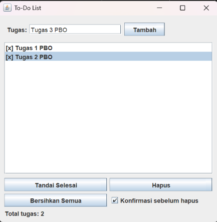

# Latihan GUI Java Swing - To-Do List

**NIM:** F1D02510017
**Nama:** Muhammad Sahrir
**Kelas:** 3C

## Cara Menjalankan

```bash
javac TodoListGUI.java
java TodoListGUI
```

## 5 Komponen Utama GUI yang Digunakan

### 1. Top-level Container Class
- **`JFrame`** – jendela utama aplikasi.

### 2. Intermediate Container Class
- **`JPanel`** – `panelUtama`, `panelInput`, `panelAksi`, `panelBawah`.
- **`JScrollPane`** – membungkus `JList` agar bisa di-scroll.

### 3. Atomic Component Class
- **`JLabel`** – keterangan dan status jumlah tugas.
- **`JTextField`** – input nama tugas.
- **`JButton`** – Tambah, Tandai Selesai, Hapus, Bersihkan Semua.
- **`JList`** (+ `DefaultListModel`) – daftar tugas.
- **`JCheckBox`** – opsi konfirmasi sebelum hapus.

### 4. Layout Classes (3 layout)
- **`BorderLayout`** – panel utama dan panel bawah.
- **`FlowLayout`** – panel input tugas.
- **`GridLayout`** – panel tombol aksi (2x2).

### 5. Event Listener
- **`ActionListener`** (interface) – override `actionPerformed()` pada semua tombol.
- **`KeyAdapter`** – override `keyPressed()`: tekan Enter untuk menambah tugas.
- **`MouseAdapter`** – override `mouseClicked()`: double click item untuk menandai selesai.
- **`WindowAdapter`** – override `windowClosing()`: konfirmasi saat menutup aplikasi.

## Screenshot

